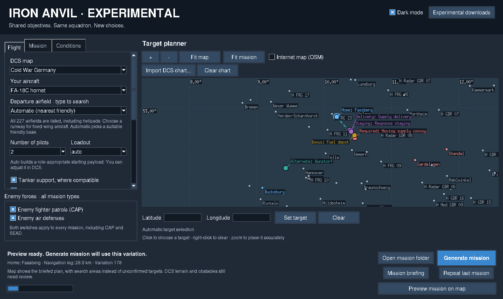

# Iron Anvil Experimental

Richer co-op missions for the aircraft and maps your group already owns. Everyone can fly the same aircraft type and work toward shared objectives.

**[Download the experimental preview and read what's new](https://github.com/SkylerErcoli/DCSMissionGeneratorJamesIronDemonAnvil/releases/tag/v1.3.1-experimental.2)**

**Your stable version is separate:** [Iron Anvil 1.2](https://github.com/SkylerErcoli/DCSMissionGeneratorJamesIronDemonAnvil/releases/tag/v1.2.0) remains unchanged for normal play. This branch uses its own installer identity, settings, cache and mission folder.

## New co-op operations

- **Broken Relay:** disable two of three fuel tanks. Destroy a command structure first to delay a finite enemy ground response by six minutes.
- **Supply Denial:** disable an ammunition structure. Destroy bonus fuel support before dispatch to cancel the ground response.
- **Rolling Thunder:** intercept a moving supply convoy. Stopping two cargo trucks before delivery earns a bonus; letting supplies arrive accelerates a still-preparing ground response. Destroy bonus fuel support before dispatch to cancel that response.
- **Choose your priorities:** either site can be attacked first. Bonus goals are optional; guards and decorative scenery never block the required objective.
- **Bring the team back:** every participating surviving pilot must recover at home or an approved friendly alternate, when enabled. A shared debrief records required/bonus goals, recovery, losses and replay seed.
- **Know when to disengage:** a two-step F10 team withdrawal command lets survivors recover with partial objective credit. Enemies stay active, and completing the main goal before recovery can still earn full success.

The ground response is one preplaced force that must travel from its staging area. It has no respawn loop. Turn it off independently if you prefer a quieter sortie. Enemy CAP and air defenses retain their own switches.

## Plan, brief and replay

Choose close-to-base, standard or longer automatic target distances, adjusted for helicopters. A target pinned on the map takes priority.

**Preview mission on map** shows the briefed objectives, staging area and recovery bases before writing a mission. Preview chooses a variation number if needed; Generate then uses that plan. Change settings to prepare another plan.

**Optional search-area intelligence:** start with an approximate area instead of exact target coordinates. Keep an airborne teammate in the area for 45 continuous seconds, then use F10 **Recon check-in** to share the updated target locations. This is a radio-intelligence game rule that works with any selected aircraft; it does not simulate sensor recognition. You can still find and attack targets visually.

Every mission includes a **DCS kneeboard** with objectives, coordinates, frequencies and a route schematic. **Mission briefing** opens a readable local page for planning and printing.

Save named **squadron presets**, share exported settings, or import settings from an existing `.miz`. **Repeat last mission** restores its settings and seed; change the variation number for another layout. Replays use the current generator, so layouts can change between app versions. Imported settings retain your own output folder.

The original five mission types remain available through **Classic single mission**. Dark/light mode, nine weather choices, protected tanker/AWACS support, friendly home-base supplies and all 472 catalogued airfields/helipads are retained.

## Getting started

1. Download the **experimental installer** from the preview page, double-click it, and open **Iron Anvil Experimental** from the Start menu. It installs beside stable 1.2 without replacing it.
2. Choose your map, aircraft and one to four pilots.
3. In **Mission**, choose an operation and target distance. Leave the target automatic or pin it on the map.
4. Choose opposition, preview the map, generate the mission, and open **Mission briefing**.
5. Host the `.miz` in DCS. Only the mission creator needs this app; friends need DCS and the selected map/aircraft modules.

No Python, commands, extra client mods or DCS scripting changes are required. Windows 10/11, 64-bit. A portable ZIP is also available; extract it and keep the entire app folder together.

The preview has its own **Experimental downloads** page. Run the newer experimental installer to update the existing experimental copy in place; uninstalling first is unnecessary. The stable app's update feed does not offer previews.

## Preview status

**This is experimental and has not been flown in DCS.** Automated tests cover generated missions, Lua state transitions and the desktop. Windows packaging checks the frozen/installed app alongside published stable 1.2. Terrain placement, roads/ground AI, static-object damage and in-simulator kneeboard display still require playtesting. Review missions in the DCS Mission Editor before your first group flight.

[Player handout](docs/experimental/START-HERE.txt) · [Completed batches and resume notes](docs/experimental/PROGRESS.md) · [Research and roadmap](docs/experimental/README.md) · [Source development](docs/DEVELOPMENT.md)
